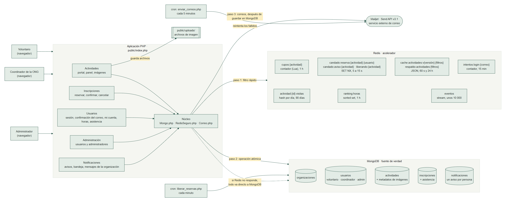
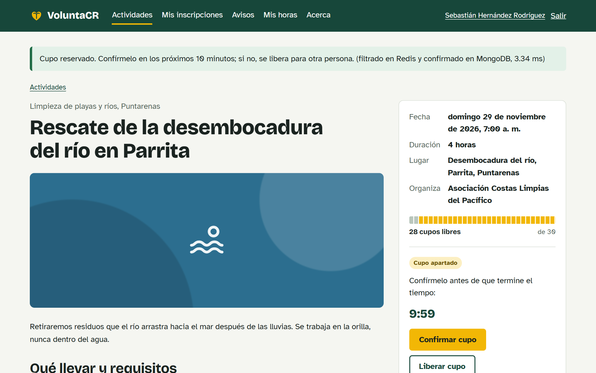
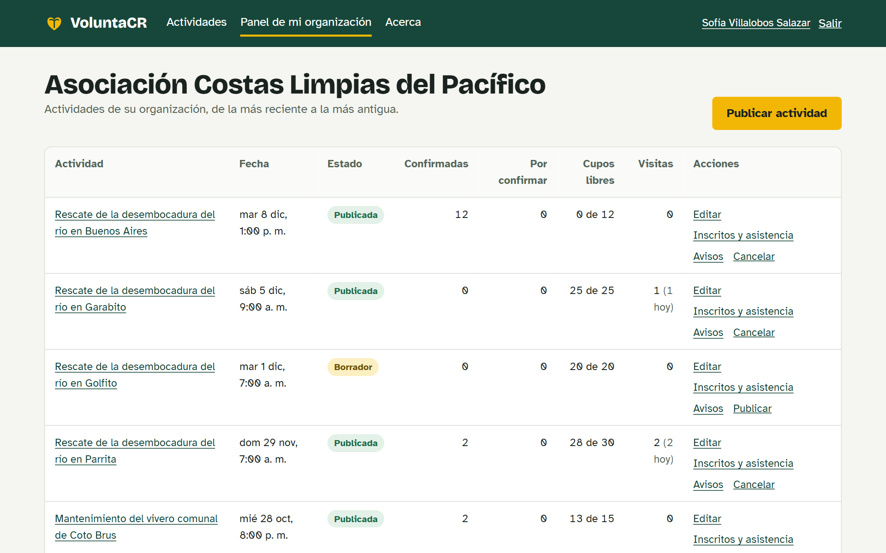
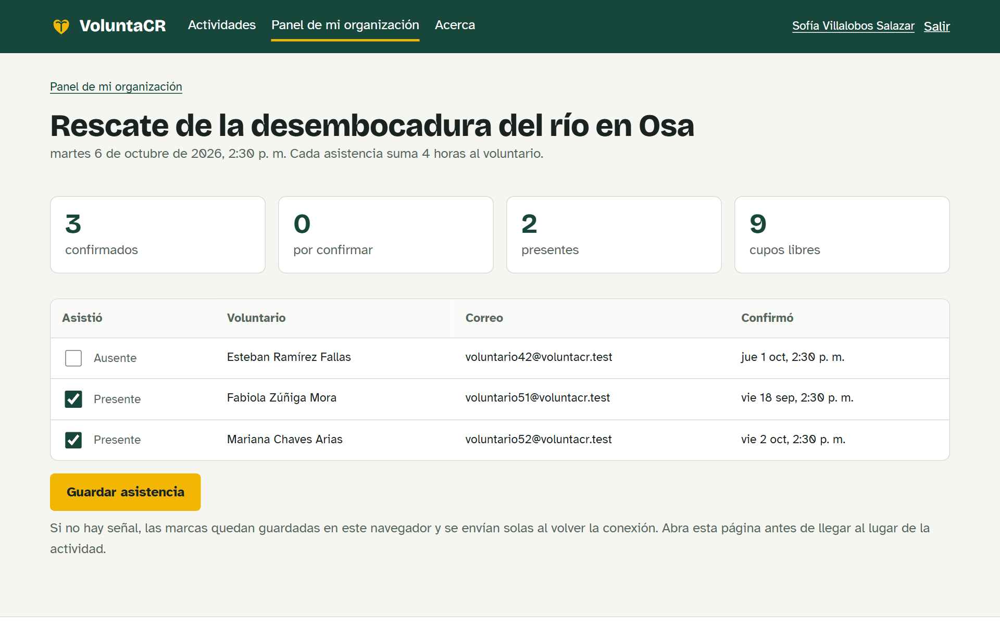
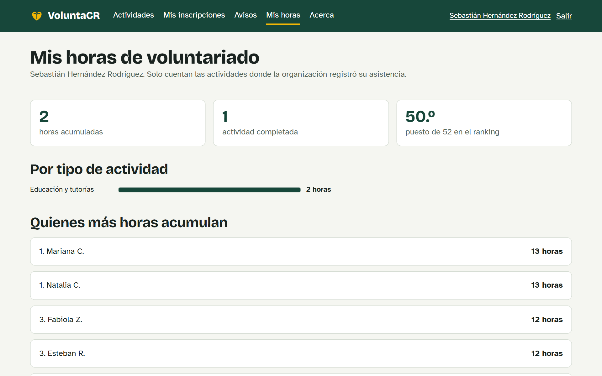
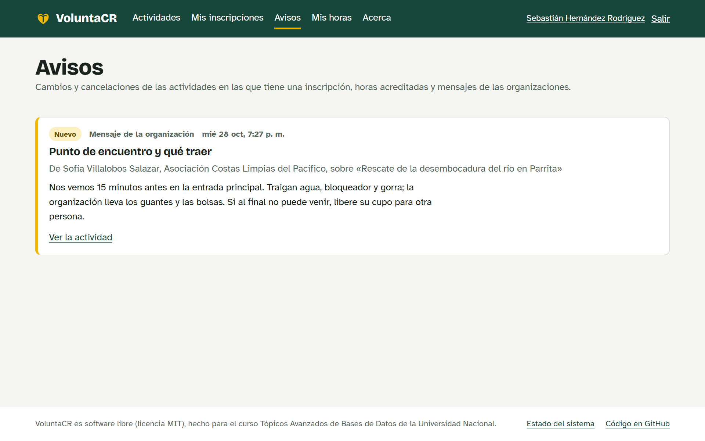
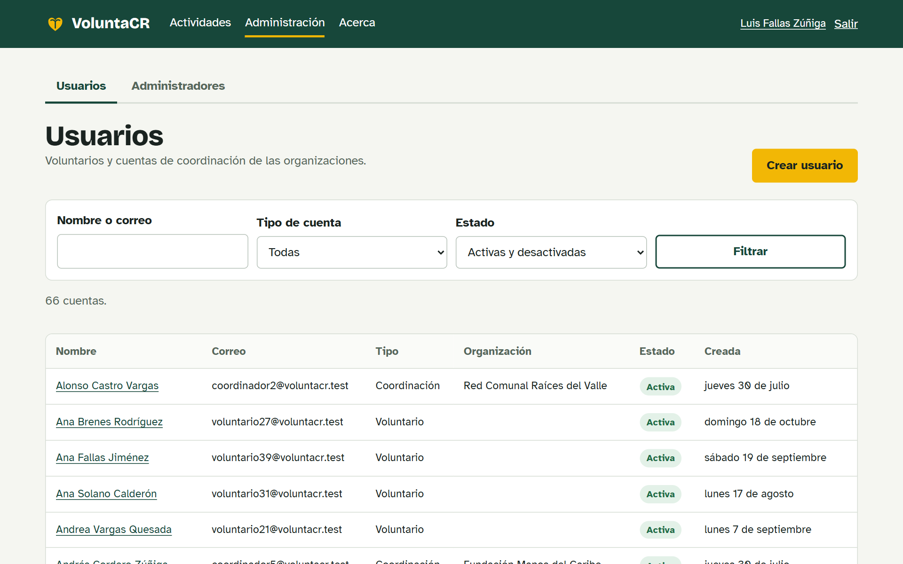
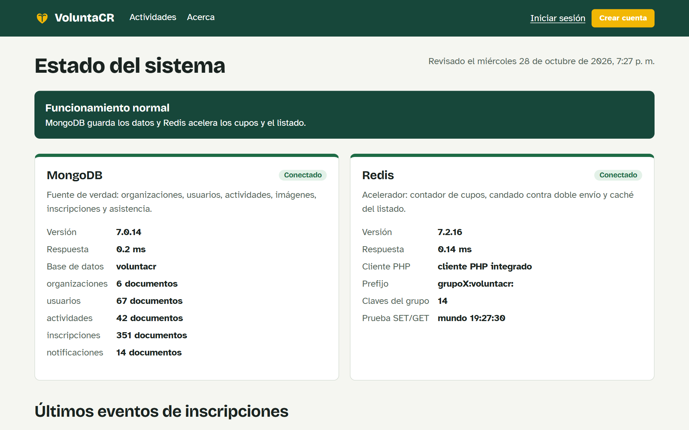
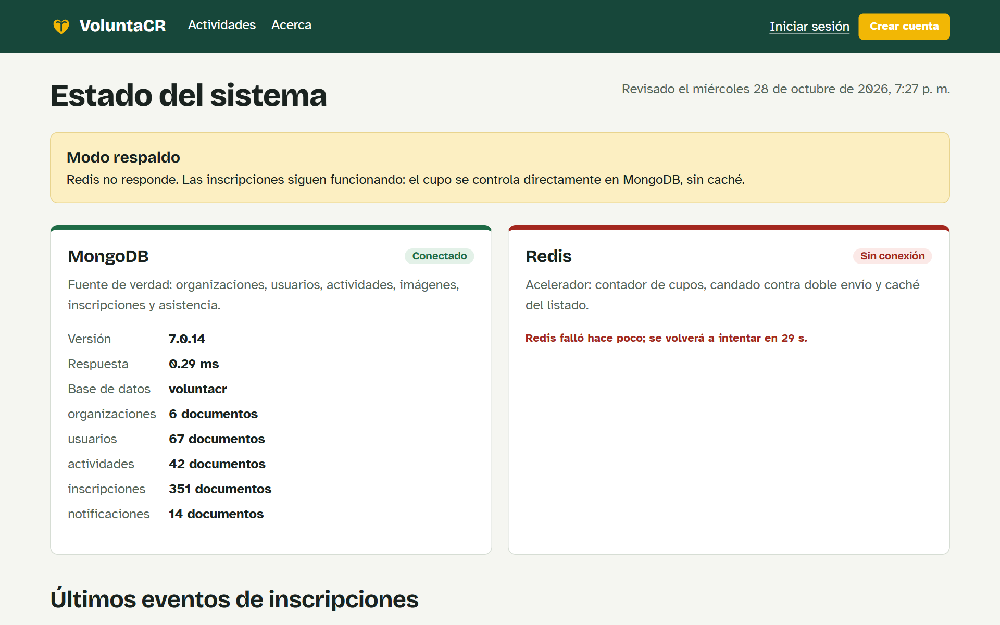

# VoluntaCR

Portal de voluntariado para organizaciones comunales y ONG de Costa Rica: publican actividades
con cupo limitado, las personas reservan su lugar sin sobrecupo, el día de la actividad se pasa
lista y cada voluntario acumula sus horas.

Proyecto final del curso **Tópicos Avanzados de Bases de Datos**, Universidad Nacional (II-2026).
Software libre con licencia [MIT](LICENSE).

**Demo en línea:** https://grupo3.crnube.net/proyecto (cuentas en [Datos de prueba](#datos-de-prueba)) ·
**Cambios por versión:** [CHANGELOG](CHANGELOG.md) · **Ficha del portal del curso:** [portal.yml](portal.yml)


## El problema

Las limpiezas de playa, reforestaciones, tutorías o campañas se coordinan hoy con formularios y
chats. Se inscribe más gente de la que cabe, quien no puede llegar no libera su espacio, nadie sabe
con certeza quién asistió y las horas de cada voluntario (que muchos necesitan para el trabajo
comunal universitario o para becas) se pierden en hojas de cálculo.

## Usuarios

- **Voluntarios:** buscan actividades por tipo y provincia, reservan un cupo, lo confirman,
  consultan sus horas y reciben avisos cuando una de sus actividades cambia.
- **Coordinadores de una organización:** publican actividades con imágenes, ven inscritos,
  registran la asistencia y envían avisos a todas las personas inscritas en una actividad.
- **Administradores:** crean y desactivan cuentas de voluntarios y coordinadores, y agregan a otros
  administradores desde una pantalla aparte.

## Alcance del MVP

**Entra:**

- Portal público con filtros (tipo, provincia, búsqueda, solo con cupo) y detalle con galería.
- Tres roles: voluntario (registro abierto), coordinación de una organización y administración.
- Confirmación del correo con un enlace enviado por Mailjet: sin confirmarlo no se puede iniciar
  sesión.
- Pantalla de usuarios para crear, editar, desactivar y restablecer la contraseña de voluntarios y
  coordinadores; pantalla aparte para agregar o desactivar administradores.
- "Mi cuenta" para todos los roles: editar datos y cambiar la contraseña.
- Publicar, editar, cancelar y eliminar actividades; subir hasta 6 imágenes por actividad.
- Reservar un cupo sin sobrecupo aunque muchas personas lo intenten a la vez; la reserva se
  confirma en 10 minutos o se libera sola.
- Cancelar la inscripción y liberar el cupo.
- Registro de asistencia por el coordinador, también sin conexión, e historial de horas del
  voluntario con su puesto en el ranking.
- Avisos a las personas inscritas, en el portal y por correo:
  - automáticos, cuando una actividad se cancela, cambia de fecha, lugar, horas o requisitos, sale
    del portal o se vuelve a publicar, y cuando se registra o se corrige la asistencia;
  - mensajes de la organización a todas las personas inscritas en una actividad (no a una sola).
- Funcionamiento con Redis caído (modo respaldo) y página de estado del sistema.

**No entra:** certificados en PDF, mapas, registro público de organizaciones y lista de espera
(ver el [roadmap](#roadmap)). El portal se usa desde el navegador del celular; no hay app aparte.

## Arquitectura

Aplicación web en PHP con dos motores (perfil B):

| Motor | Rol | Qué guarda |
|---|---|---|
| **MongoDB** (el del servidor del curso) | Fuente de verdad | organizaciones, usuarios y roles, actividades (con metadatos de imágenes), inscripciones, asistencia y los avisos de cada persona |
| **Redis** | Acelerador | en strings, el contador de cupos, los candados contra el doble envío, la caché del listado y los intentos de inicio de sesión; las visitas por actividad en un hash, el ranking de horas en un sorted set y la bitácora de inscripciones en un stream |

Si Redis no responde, todo sigue funcionando solo con MongoDB, que garantiza el cupo con una
operación atómica. Si MongoDB no responde, el listado se sigue mostrando desde la caché.

Los correos (confirmación de la cuenta y avisos) salen por **Mailjet**, un servicio externo, no un
motor de datos. Si Mailjet no responde, los avisos quedan igual en el portal y los correos se
reintentan después (decisión D25).

MongoDB Atlas es MongoDB alojado en la nube, no otro motor: se puede usar en lugar del MongoDB del
servidor cambiando solo `MONGO_URI`. No se usan los dos a la vez (ver la decisión D10).



Más detalle: [arquitectura](docs/arquitectura/README.md) ·
[modelo de datos](docs/modelo-datos.md) · [claves de Redis](docs/redis-claves.md) ·
[decisiones técnicas](docs/decisiones.md)

## Capturas

<table>
<tr>
<td width="50%"><br><b>Reserva.</b> El cupo queda apartado mientras corre la cuenta regresiva; el mensaje dice qué motor resolvió la reserva y en cuánto tiempo.</td>
<td width="50%"><br><b>Panel de la organización.</b> Actividades, inscritos y visitas de cada una.</td>
</tr>
<tr>
<td><br><b>Asistencia.</b> El coordinador marca a las personas presentes, aun sin señal.</td>
<td><br><b>Mis horas.</b> Horas por tipo de actividad y puesto en el ranking.</td>
</tr>
<tr>
<td><br><b>Avisos.</b> Cambios en las actividades y mensajes de la organización.</td>
<td><br><b>Administración.</b> Cuentas de voluntarios y coordinadores.</td>
</tr>
<tr>
<td><br><b>Estado del sistema.</b> MongoDB y Redis conectados, con su versión y su tiempo de respuesta.</td>
<td><br><b>Modo respaldo.</b> Con Redis caído, todo sigue funcionando solo con MongoDB.</td>
</tr>
</table>

## Requisitos

- PHP 8.1 o superior con las extensiones `mongodb`, `mbstring` y `fileinfo` (no se usa Composer).
  Sin `mbstring` o `fileinfo` los scripts de consola funcionan, pero las páginas fallan;
  `php scripts/probar_conexiones.php` avisa si falta alguna. La extensión `redis` es opcional: sin
  ella se usa el cliente integrado (`src/Nucleo/RedisPolyfill.php`).
- MongoDB 6 o superior (local o Atlas).
- Redis 6 o superior (opcional: sin Redis funciona en modo respaldo).
- Una cuenta de Mailjet para enviar correos (opcional: sin ella, los correos se anotan en
  `storage/correos.log`). PHP la usa con `allow_url_fopen` y la extensión `openssl`, que vienen
  activas casi siempre.

En el servidor del curso, PHP, MongoDB y Redis los instaló el profesor
([ver Instalación](#en-el-servidor-del-curso-virtualmin)). Con Docker (opción A) o Codespaces
(opción B) no hay que instalar nada de esto.

## Instalación

La aplicación quedó instalada en el **servidor en la nube del curso**, que se administra con el
panel **Virtualmin**: es la [demo en línea](https://grupo3.crnube.net/proyecto). Las opciones A, B
y C sirven para instalarla en otra máquina, por ejemplo para desarrollo o para probarla desde cero.

### En el servidor del curso (Virtualmin)

**El profesor instaló PHP, MongoDB y Redis en el servidor**, así que ahí el grupo no tuvo que
instalar nada de eso. La aplicación usa el MongoDB del servidor, no Atlas (D10), y el Redis que
comparten los grupos, donde todas las claves de la aplicación llevan el prefijo `grupo3:voluntacr:`.
Para instalar la aplicación ahí:

1. Clonar el repositorio en la cuenta del grupo y servir `public/` en la subcarpeta `/proyecto`
   (`APP_BASE=/proyecto`).
2. Copiar `.env.example` como `.env` y llenarlo: la URI del MongoDB del servidor con el usuario del
   grupo, los datos del Redis compartido con `REDIS_PREFIX=grupo3:voluntacr:`, `APP_URL`, las claves
   de Mailjet y `APP_DEBUG=false`.
3. Correr `php scripts/probar_conexiones.php`, `php scripts/crear_esquema.php` y
   `php scripts/cargar_datos.php --limpiar`.
4. En Virtualmin, programar `scripts/liberar_reservas.php` cada minuto y
   `scripts/enviar_correos.php` cada 5 minutos.
5. Abrir https://grupo3.crnube.net/proyecto/estado: debe decir **Funcionamiento normal**.

Los comandos completos, los permisos de las carpetas y cómo actualizar después de cada versión están
en [docs/despliegue-virtualmin.md](docs/despliegue-virtualmin.md).

### Opción A: Docker (recomendada)

Con Docker y Docker Compose:

```bash
git clone https://github.com/41varado/voluntary-hub.git voluntacr
cd voluntacr
cp .env.example .env
docker compose up -d --build
docker compose exec app php scripts/crear_esquema.php
docker compose exec app php scripts/cargar_datos.php --limpiar
```

Abrir http://localhost:8080

### Opción B: GitHub Codespaces (sin instalar nada)

1. En la página del repositorio: **Code → Codespaces → Create codespace on main**. Hace falta una
   cuenta de GitHub; el plan gratuito incluye horas de Codespaces cada mes.
2. El Codespace ejecuta solo `scripts/codespaces.sh`: crea el `.env`, levanta PHP, MongoDB y Redis
   con Docker, crea el esquema y carga los datos de prueba. La primera vez tarda unos minutos.
3. Cuando la terminal diga «Listo», abra la pestaña **PORTS** y el puerto **8080**.

Si el Codespace se detiene, al abrirlo otra vez los contenedores se levantan solos.

### Opción C: PHP instalado en la computadora

Con PHP (con las extensiones de los [requisitos](#requisitos)), MongoDB y, si lo tiene, Redis,
corriendo en la misma máquina:

```bash
git clone https://github.com/41varado/voluntary-hub.git voluntacr
cd voluntacr
cp .env.example .env
php scripts/probar_conexiones.php
php scripts/crear_esquema.php
php scripts/cargar_datos.php --limpiar
php -S localhost:8080 -t public public/index.php
```

Abrir http://localhost:8080

- `probar_conexiones.php` muestra la versión de cada motor y avisa si falta una extensión de PHP.
  Si dice que falta alguna, actívela antes de seguir.
- Sin Redis, ponga `REDIS_DESHABILITADO=true` en el `.env`: la aplicación funciona en modo
  respaldo, solo con MongoDB, y `probar_conexiones.php` lo dice con una «✘» en Redis.
- Si tiene `mongosh`, `mongosh --nodb --quiet scripts/mongosh/crear_esquema.js` crea el mismo
  esquema que `crear_esquema.php`, leyendo la URI del `.env`.

<details>
<summary><b>Notas para Windows</b></summary>

- **PHP:** descargue el zip *Non Thread Safe* x64 de https://windows.php.net/download, copie
  `php.ini-development` como `php.ini` y quite el `;` del principio de estas líneas:
  `extension_dir = "ext"`, `extension=fileinfo`, `extension=mbstring` y `extension=openssl`.
- **Extensión `mongodb`:** en https://github.com/mongodb/mongo-php-driver/releases, descargue el zip
  de su versión de PHP (por ejemplo, el que termina en `8.1-nts-vs16-x86_64.zip` para PHP 8.1 NTS
  de 64 bits), copie `php_mongodb.dll` en la carpeta `ext` y agregue `extension=mongodb` al
  `php.ini`. `php -m` debe listar `mongodb`, `mbstring` y `fileinfo`.
- **MongoDB:** MongoDB Community Server, con el instalador `.msi` de
  https://www.mongodb.com/try/download/community.
- **Redis** no tiene versión oficial para Windows: úselo con WSL o con Docker
  (`docker run -d -p 6379:6379 redis:7-alpine`), o trabaje sin él con `REDIS_DESHABILITADO=true`.
- Los comandos de arriba funcionan en Git Bash y en PowerShell. En el símbolo del sistema (`cmd`),
  cambie `cp` por `copy`.

</details>

### Comprobar la instalación

1. Abra `/estado` (http://localhost:8080/estado): debe decir **Funcionamiento normal**, con MongoDB
   y Redis conectados, o **Modo respaldo** si trabaja sin Redis.
2. Entre con alguna de las cuentas de [Datos de prueba](#datos-de-prueba).
3. Si quiere probarlo todo: `php scripts/pruebas/correr.php --sin-espera` (con Docker,
   `docker compose exec app php scripts/pruebas/correr.php --url=http://localhost --sin-espera`)
   recorre por HTTP el caso normal, los errores de conexión y los datos inválidos en un par de
   minutos. Crea actividades «Prueba …», las borra al terminar y guarda el informe en
   `docs/pruebas/resultados/`.

## Variables de entorno

Todas están en [`.env.example`](.env.example), con un comentario cada una. Una variable del sistema
(por ejemplo, las que define Docker) tiene prioridad sobre el `.env`.

| Variable | Ejemplo | Para qué |
|---|---|---|
| **Aplicación** | | |
| `APP_NOMBRE` | `VoluntaCR` | Nombre del sitio y de los correos |
| `APP_DEBUG` | `false` | `true` solo en desarrollo: muestra el detalle de los errores |
| `APP_MODO_DEMO` | `true` | Muestra qué motor resolvió cada reserva y en cuánto tiempo |
| `APP_BASE` | vacío | Subcarpeta si el sitio no está en la raíz del dominio (por ejemplo, `/proyecto`) |
| `APP_ZONA_HORARIA` | `America/Costa_Rica` | Zona horaria de las fechas |
| `APP_REPOSITORIO` | `https://github.com/41varado/voluntary-hub` | Enlace al código en «Acerca» y al pie de página |
| `APP_URL` | `http://localhost:8080` | Dirección pública del sitio, sin `APP_BASE`, para los enlaces de los correos |
| **MongoDB** | | |
| `MONGO_URI` | `mongodb://127.0.0.1:27017` | Conexión a MongoDB (local o Atlas); solo se escribe en el `.env` |
| `MONGO_DB` | `voluntacr` | Nombre de la base |
| `MONGO_TIMEOUT_MS` | `2500` | Milisegundos de espera antes de dar MongoDB por caído |
| **Redis** | | |
| `REDIS_HOST`, `REDIS_PORT` | `127.0.0.1`, `6379` | Conexión a Redis |
| `REDIS_USERNAME`, `REDIS_PASSWORD` | vacíos | Usuario y contraseña, si el Redis los pide |
| `REDIS_DB` | `0` | Número de base de Redis |
| `REDIS_PREFIX` | `grupoX:voluntacr:` | Prefijo de todas las claves; obligatorio en el Redis compartido del curso (`grupo3:voluntacr:`) |
| `REDIS_TIMEOUT` | `0.5` | Segundos de espera antes de pasar a modo respaldo |
| `REDIS_REINTENTO_SEG` | `30` | Segundos sin volver a intentar después de una falla |
| `REDIS_DESHABILITADO` | `false` | `true` simula Redis caído (pruebas y mediciones) o permite trabajar sin Redis |
| **Correo con Mailjet** | | |
| `MAILJET_API_KEY`, `MAILJET_API_SECRET` | vacías | Claves de Mailjet; vacías, no sale ningún correo |
| `CORREO_REMITENTE` | `avisos@su-dominio.cr` | Remitente validado en Mailjet |
| `CORREO_REMITENTE_NOMBRE` | `VoluntaCR` | Nombre del remitente |
| `MAILJET_TIMEOUT` | `5` | Segundos de espera antes de dejar el correo para el reintento |
| **Sesiones y reglas** | | |
| `SESION_VERIFICAR_SEG` | `60` | Cada cuántos segundos se revisa que la cuenta siga activa (D12) |
| `RESERVA_MINUTOS` | `10` | Minutos para confirmar una reserva antes de que el cupo se libere |
| `CACHE_TTL_SEG` | `60` | Segundos que dura en caché el listado de actividades |
| `SUBIDAS_MAX_MB` | `2` | Tamaño máximo de cada imagen subida |

## Correo con Mailjet

1. Cree una cuenta en [Mailjet](https://www.mailjet.com/). El plan gratuito envía 200 correos por
   día (6000 al mes); lo que pasa del día queda en cola.
2. En *Account settings > API Key Management*, copie la clave de la API y la secreta en
   `MAILJET_API_KEY` y `MAILJET_API_SECRET`. La secreta se muestra una sola vez.
3. En *Account settings > Senders & Domains*, agregue la dirección remitente y ábrala en el correo
   que le envía Mailjet para validarla. Póngala en `CORREO_REMITENTE`.
4. Ponga en `APP_URL` la dirección pública del sitio, sin la subcarpeta de `APP_BASE`.
5. `php scripts/probar_conexiones.php` prueba las claves y el remitente en modo de prueba de Mailjet,
   sin entregar ningún correo.
6. En el servidor, programe `scripts/enviar_correos.php` cada 5 minutos para reintentar los correos
   que fallen ([despliegue](docs/despliegue-virtualmin.md)).

Sin las claves, la aplicación funciona igual. Los correos se anotan en `storage/correos.log` y la
página «Confirme su correo» muestra el enlace en el mismo navegador, para poder probar. Las
direcciones `.test` de los datos de prueba nunca reciben correos.

## Datos de prueba

`php scripts/cargar_datos.php --limpiar` genera datos sintéticos y reproducibles
(ver [docs/fuente-datos.md](docs/fuente-datos.md)). Cuentas:

| Rol | Correo | Contraseña |
|---|---|---|
| Administración | `admin@voluntacr.test` | `Admin2026` |
| Coordinación | `coordinador1@voluntacr.test` (hasta 6) | `Coordina2026` |
| Voluntario | `voluntario1@voluntacr.test` (hasta 60; la 60 está desactivada) | `Voluntario2026` |

Todas tienen el correo confirmado y algunas ya tienen avisos. Una cuenta nueva, creada en
**Crear cuenta** o desde Administración, tiene que confirmar su correo antes de iniciar sesión.

En una instalación nueva sin datos de prueba, el primer administrador se crea con
`php scripts/crear_admin.php "Nombre" correo "clave"`. Las cuentas que crean los scripts de
consola ya tienen el correo confirmado.

## Uso

1. Como voluntario: **Crear cuenta** → abrir el enlace que llega al correo (sin Mailjet aparece en
   la misma página) → **Actividades** → elegir una con cupo → **Reservar cupo** → **Confirmar cupo**
   antes de que termine la cuenta regresiva. En **Mis inscripciones** se puede cancelar.
2. Como coordinador: **Panel de mi organización** → **Publicar actividad** → agregar imágenes.
   El día de la actividad: **Inscritos y asistencia** → marcar presentes → **Guardar asistencia**.
   En **Avisos** de cada actividad se escribe a todas las personas inscritas y se ve cuántas lo
   leyeron.
3. El voluntario ve sus horas en **Mis horas** y los avisos en **Avisos**; el número junto al menú
   cuenta los que no ha leído. Cualquier persona cambia sus datos y su contraseña en **Mi cuenta**
   (clic en su nombre); ahí el voluntario elige si recibe los avisos también por correo.
4. Como administrador: **Administración** → pestaña **Usuarios** (crear voluntarios o coordinadores,
   editar, desactivar, restablecer contraseña) y pestaña **Administradores** (agregar otro
   administrador confirmando su propia contraseña, o desactivar uno).
5. **Estado del sistema** (`/estado`) muestra si MongoDB y Redis responden y en qué modo funciona.
6. Para ver la tolerancia a fallos con Docker: `docker compose pause redis` y recargue cualquier
   página. Aparece la franja «Modo respaldo» y se puede seguir reservando, ahora solo con MongoDB.
   Con `docker compose unpause redis`, a más tardar 30 s después vuelve el modo normal. Los pasos
   completos están en las pruebas EC-01 a EC-06.

## Scripts

| Script | Para qué |
|---|---|
| `scripts/probar_conexiones.php` | Comprueba las extensiones de PHP, la conexión a MongoDB y a Redis, y Mailjet |
| `scripts/crear_esquema.php` | Crea colecciones con JSON Schema e índices |
| `scripts/mongosh/crear_esquema.js` | El mismo esquema con mongosh, sin PHP; lee la URI del `.env` (`mongosh --nodb --quiet scripts/mongosh/crear_esquema.js`) |
| `scripts/cargar_datos.php` | Genera los datos de prueba (`--limpiar`, `--voluntarios=N`, `--semilla=N`) |
| `scripts/crear_admin.php` | Crea el primer administrador |
| `scripts/crear_coordinador.php` | Crea una cuenta de coordinación |
| `scripts/liberar_reservas.php` | Libera reservas vencidas (para cron, cada minuto) |
| `scripts/enviar_correos.php` | Reintenta los correos de los avisos que fallaron (para cron, cada 5 minutos) |
| `scripts/reconciliar_cupos.php` | Revisa que los cupos coincidan con las inscripciones |
| `scripts/medir_cupos.php` | Medición de reservas simultáneas con y sin Redis |
| `scripts/medir_listado.php` | Medición del listado de actividades con y sin caché |
| `scripts/medir_indice.php` | Medición de la consulta del portal con y sin índice (`explain`) |
| `scripts/pruebas/correr.php` | Pruebas automatizadas de `docs/pruebas` (caso normal, error de conexión, datos inválidos) |
| `scripts/codespaces.sh` | Prepara todo en Codespaces o en cualquier máquina con Docker |
| `scripts/crear_backlog.sh` | Crea hitos e issues en GitHub |

## Estructura

```
public/            raíz web: index.php, assets/, uploads/
src/Nucleo/        configuración, enrutador, sesión, Mongo.php, RedisSeguro.php, Correo.php (Mailjet)
src/modulos/       un módulo por área: base, estado, actividades, inscripciones, usuarios, administracion, notificaciones
src/vistas/        diseño general y páginas de error
scripts/           esquema (también para mongosh), datos, mediciones, pruebas y cron
data/              archivos para el generador de datos
docs/              arquitectura, modelo de datos, decisiones, pruebas, mediciones, bitácoras
```

## Pruebas

Documentadas en [docs/pruebas](docs/pruebas/README.md), con el resultado de cada paso:

| Grupo | Pruebas | Qué cubren | Estado |
|---|---|---|---|
| [Caso normal](docs/pruebas/caso-normal.md) | CN-01 a CN-03 | El flujo principal, la actividad llena y la reserva que vence | Pasan |
| [Error de conexión](docs/pruebas/error-conexion.md) | EC-01 a EC-06 | Redis caído, MongoDB caído y la vuelta de cada uno | Pasan |
| [Datos inválidos](docs/pruebas/datos-invalidos.md) | DI-01 a DI-09 | Formularios, imágenes falsas, direcciones manipuladas, CSRF y JSON Schema | Pasan |

`scripts/pruebas/correr.php` recorre por HTTP los pasos que se pueden automatizar y guarda el informe
en [docs/pruebas/resultados](docs/pruebas/resultados); los pasos con un motor detenido se hicieron a
mano y tienen capturas.

## Mediciones

Medidas en GitHub Codespaces el 26 de octubre de 2026, con la mediana de 3 repeticiones. Detalle,
CSV e interpretación en [docs/mediciones](docs/mediciones/README.md).

| Medición | Con Redis o con índice | Sin Redis o sin índice |
|---|---|---|
| Reservas simultáneas (500 sobre 50 cupos) | 438,6 ms en total, sobrecupo 0 | 758,7 ms en total, sobrecupo 0 |
| Listado de actividades (latencia mediana) | 0,160 ms | 0,958 ms |
| Consulta del portal con categoría y provincia | 9 documentos examinados, 0,381 ms | 20 042 documentos examinados, 12,526 ms |

MongoDB impide el sobrecupo por sí solo; Redis le quita carga, porque las reservas rechazadas y casi
todo el listado ya no le llegan. El índice compuesto del portal hace que la consulta lea solo los
documentos que muestra.

## Roadmap

- **En 1 mes:**
  - recordatorio por correo el día antes de la actividad;
  - lista de espera cuando la actividad se llena: el cupo que se libera se ofrece a la siguiente
    persona;
  - recuperación de la contraseña por correo, con un enlace como el de la confirmación (D23);
  - exportar la asistencia de una actividad a CSV.
- **En 6 meses:**
  - certificados de horas en PDF, con un código para verificarlos;
  - registro público de organizaciones, con aprobación de la administración;
  - mapa de actividades por cantón;
  - aplicación instalable (PWA) para pasar lista sin conexión desde el celular.
- **Como trabajo final de graduación:** predicción de inasistencia para sobre-reservar cupos sin
  dejar gente afuera, y evaluación de la consistencia entre MongoDB y Redis bajo fallos.

## Contribuir

- Para reportar un error o proponer un cambio, abra un issue.
- Cada cambio entra a `main` con un pull request desde una rama propia (D16), con las pruebas
  automatizadas pasando.
- Los textos de la interfaz van en español y tratan de «usted». Los mensajes y las confirmaciones
  se muestran en la página, nunca en ventanas del navegador (`alert` o `confirm`).
- Cada archivo de `src/modulos/` dice al inicio quién es su responsable.

## Equipo

| Integrante | Rol en el proyecto |
|---|---|
| _Jafet Alvarado Barboza_ (@41varado) | Plataforma, administración de usuarios y despliegue |
| _Luis Aguilar Monge_ (@Luis9628) | Actividades y MongoDB |
| _Manuel Mora Sandi_ (@manuelmora-jpg / Manuel01011) | Inscripciones, Redis y tolerancia a fallos |
| _Derek Rojas Mendoza_ (@DerekJRM) | Usuarios, asistencia y datos de prueba |

## Licencia

[MIT](LICENSE). Puede usarlo, modificarlo y distribuirlo libremente.
