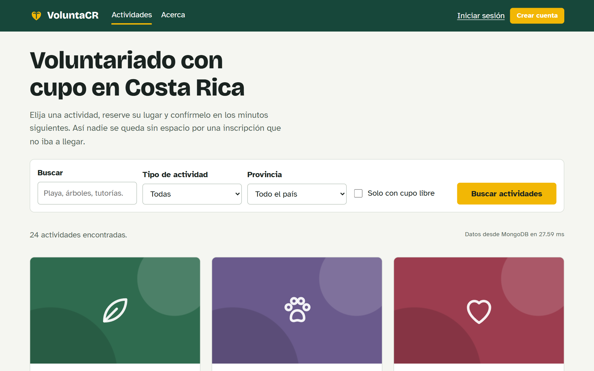
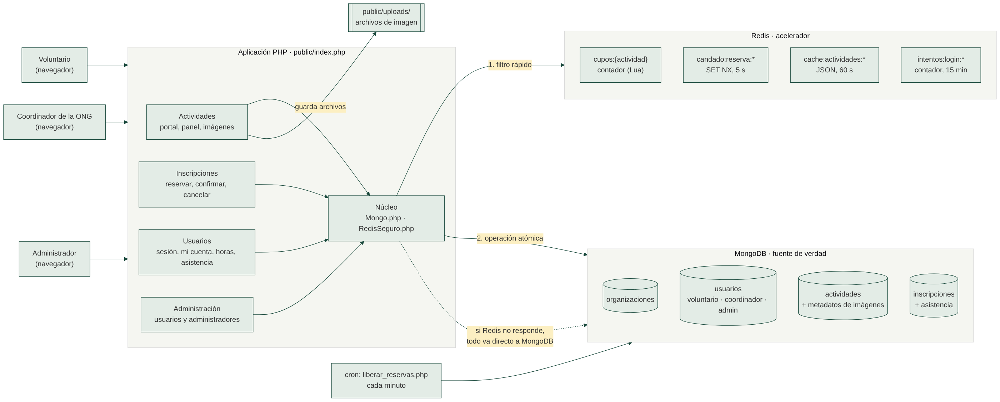

# VoluntaCR

Portal de voluntariado para organizaciones comunales y ONG de Costa Rica: publican actividades
con cupo limitado, las personas reservan su lugar sin sobrecupo, el día de la actividad se pasa
lista y cada voluntario acumula sus horas.

Proyecto final del curso **Tópicos Avanzados de Bases de Datos**, Universidad Nacional (II-2026).
Software libre con licencia [MIT](LICENSE).



## El problema

Las limpiezas de playa, reforestaciones, tutorías o campañas se coordinan hoy con formularios y
chats. Se inscribe más gente de la que cabe, quien no puede llegar no libera su espacio, nadie sabe
con certeza quién asistió y las horas de cada voluntario (que muchos necesitan para el trabajo
comunal universitario o para becas) se pierden en hojas de cálculo.

## Usuarios

- **Voluntarios:** buscan actividades por tipo y provincia, reservan un cupo, lo confirman y
  consultan sus horas.
- **Coordinadores de una organización:** publican actividades con imágenes, ven inscritos y
  registran la asistencia.
- **Administradores:** crean y desactivan cuentas de voluntarios y coordinadores, y agregan a otros
  administradores desde una pantalla aparte.

## Alcance del MVP

**Entra:**

- Portal público con filtros (tipo, provincia, búsqueda, solo con cupo) y detalle con galería.
- Tres roles: voluntario (registro abierto), coordinación de una organización y administración.
- Pantalla de usuarios para crear, editar, desactivar y restablecer la contraseña de voluntarios y
  coordinadores; pantalla aparte para agregar o desactivar administradores.
- "Mi cuenta" para todos los roles: editar datos y cambiar la contraseña.
- Publicar, editar, cancelar y eliminar actividades; subir hasta 6 imágenes por actividad.
- Reservar un cupo sin sobrecupo aunque muchas personas lo intenten a la vez; la reserva se
  confirma en 10 minutos o se libera sola.
- Cancelar la inscripción y liberar el cupo.
- Registro de asistencia por el coordinador e historial de horas del voluntario.
- Funcionamiento con Redis caído (modo respaldo) y página de estado del sistema.

**No entra (roadmap):** avisos por correo, certificados en PDF, mapas, registro público de
organizaciones y lista de espera. El portal se usa desde el navegador del celular; no hay app aparte.

## Arquitectura

Aplicación web en PHP con dos motores (perfil B):

| Motor | Rol | Qué guarda |
|---|---|---|
| **MongoDB** (el del servidor del curso) | Fuente de verdad | organizaciones, usuarios y roles, actividades (con metadatos de imágenes), inscripciones y asistencia |
| **Redis** | Acelerador | contador de cupos, candado contra doble envío, caché del listado, intentos de inicio de sesión |

Si Redis no responde, todo sigue funcionando solo con MongoDB, que garantiza el cupo con una
operación atómica. Si MongoDB no responde, el listado se sigue mostrando desde la caché.

MongoDB Atlas es MongoDB alojado en la nube, no otro motor: se puede usar en lugar del MongoDB del
servidor cambiando solo `MONGO_URI`. No se usan los dos a la vez (ver la decisión D10).



Más detalle: [arquitectura](docs/arquitectura/README.md) ·
[modelo de datos](docs/modelo-datos.md) · [claves de Redis](docs/redis-claves.md) ·
[decisiones técnicas](docs/decisiones.md)

## Requisitos

- PHP 8.1 o superior con las extensiones `mongodb` y `redis` (no se usa Composer).
- MongoDB 6 o superior (local o Atlas).
- Redis 6 o superior (opcional: sin Redis funciona en modo respaldo).

## Instalación local

### Opción A: Docker (recomendada)

```bash
git clone https://github.com/USUARIO/voluntacr.git
cd voluntacr
cp .env.example .env
docker compose up -d --build
docker compose exec app php scripts/crear_esquema.php
docker compose exec app php scripts/cargar_datos.php --limpiar
```

Abrir http://localhost:8080

### Opción B: PHP instalado en la computadora

Con MongoDB y Redis corriendo en la misma máquina:

```bash
cp .env.example .env
php scripts/probar_conexiones.php
php scripts/crear_esquema.php
php scripts/cargar_datos.php --limpiar
php -S localhost:8080 -t public public/index.php
```

En el servidor del curso: ver [docs/despliegue-virtualmin.md](docs/despliegue-virtualmin.md).

## Variables de entorno

Todas están documentadas en [`.env.example`](.env.example). Las principales:

| Variable | Ejemplo | Para qué |
|---|---|---|
| `MONGO_URI` | `mongodb://127.0.0.1:27017` | Conexión a MongoDB (local o Atlas) |
| `MONGO_DB` | `voluntacr` | Nombre de la base |
| `REDIS_HOST`, `REDIS_PORT`, `REDIS_PASSWORD` | `127.0.0.1`, `6379` | Conexión a Redis |
| `REDIS_PREFIX` | `grupoX:voluntacr:` | Prefijo obligatorio de todas las claves |
| `REDIS_DESHABILITADO` | `false` | `true` simula Redis caído |
| `RESERVA_MINUTOS` | `10` | Tiempo para confirmar una reserva |
| `APP_MODO_DEMO` | `true` | Muestra qué motor resolvió cada reserva y en cuánto tiempo |

## Datos de prueba

`php scripts/cargar_datos.php --limpiar` genera datos sintéticos y reproducibles
(ver [docs/fuente-datos.md](docs/fuente-datos.md)). Cuentas:

| Rol | Correo | Contraseña |
|---|---|---|
| Administración | `admin@voluntacr.test` | `Admin2026` |
| Coordinación | `coordinador1@voluntacr.test` (hasta 6) | `Coordina2026` |
| Voluntario | `voluntario1@voluntacr.test` (hasta 60; la 60 está desactivada) | `Voluntario2026` |

En una instalación nueva sin datos de prueba, el primer administrador se crea con
`php scripts/crear_admin.php "Nombre" correo "clave"`.

## Uso

1. Como voluntario: **Actividades** → elegir una con cupo → **Reservar cupo** → **Confirmar cupo**
   antes de que termine la cuenta regresiva. En **Mis inscripciones** se puede cancelar.
2. Como coordinador: **Panel de mi organización** → **Publicar actividad** → agregar imágenes.
   El día de la actividad: **Inscritos y asistencia** → marcar presentes → **Guardar asistencia**.
3. El voluntario ve sus horas en **Mis horas**. Cualquier persona cambia sus datos y su contraseña
   en **Mi cuenta** (clic en su nombre).
4. Como administrador: **Administración** → pestaña **Usuarios** (crear voluntarios o coordinadores,
   editar, desactivar, restablecer contraseña) y pestaña **Administradores** (agregar otro
   administrador confirmando su propia contraseña, o desactivar uno).
5. **Estado del sistema** (`/estado`) muestra si MongoDB y Redis responden y en qué modo funciona.

## Scripts

| Script | Para qué |
|---|---|
| `scripts/probar_conexiones.php` | Comprueba la conexión a MongoDB y Redis |
| `scripts/crear_esquema.php` | Crea colecciones con JSON Schema e índices |
| `scripts/cargar_datos.php` | Genera los datos de prueba (`--limpiar`, `--voluntarios=N`, `--semilla=N`) |
| `scripts/crear_admin.php` | Crea el primer administrador |
| `scripts/crear_coordinador.php` | Crea una cuenta de coordinación |
| `scripts/liberar_reservas.php` | Libera reservas vencidas (para cron, cada minuto) |
| `scripts/reconciliar_cupos.php` | Revisa que los cupos coincidan con las inscripciones |
| `scripts/medir_cupos.php` | Medición de reservas simultáneas con y sin Redis |
| `scripts/crear_backlog.sh` | Crea hitos e issues en GitHub |

## Estructura

```
public/            raíz web: index.php, assets/, uploads/
src/Nucleo/        configuración, enrutador, sesión, Mongo.php, RedisSeguro.php
src/modulos/       un módulo por área: base, estado, actividades, inscripciones, usuarios, administracion
src/vistas/        diseño general y páginas de error
scripts/           esquema, datos, mediciones, cron
data/              archivos para el generador de datos
docs/              arquitectura, modelo de datos, decisiones, mediciones, bitácoras
```

## Mediciones

Se completan en el seguimiento 3. Ver [docs/mediciones](docs/mediciones/README.md).

## Equipo

| Integrantes |
|---|
| _Manuel Mora Sandi_ (@manuelmora-jpg) |
| _Luis Aguilar Monge_ (@Luis9628) |
| _Dereck Rojas Mendoza_ (@DerekJRM) |
| _Jafet Alvarado Barboza_ (@41varado) |

## Roadmap

- **1 mes:** avisos por correo al reservar y antes de la actividad; lista de espera cuando se llena;
  recuperación de contraseña por correo.
- **6 meses:** certificados de horas en PDF verificables; registro de organizaciones con aprobación;
  mapa de actividades.
- **Posible trabajo final de graduación:** predicción de inasistencia para sobre-reservar cupos
  sin dejar gente afuera, y evaluación de la consistencia entre motores bajo fallos.

## Licencia

[MIT](LICENSE). Puede usarlo, modificarlo y distribuirlo libremente.
