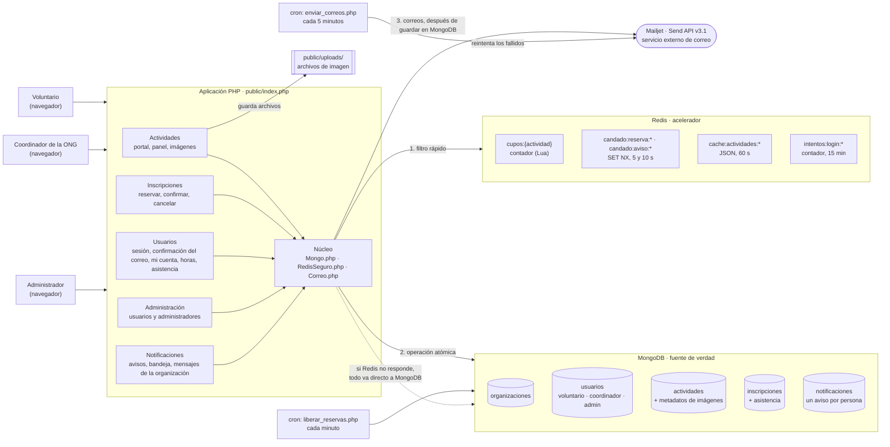
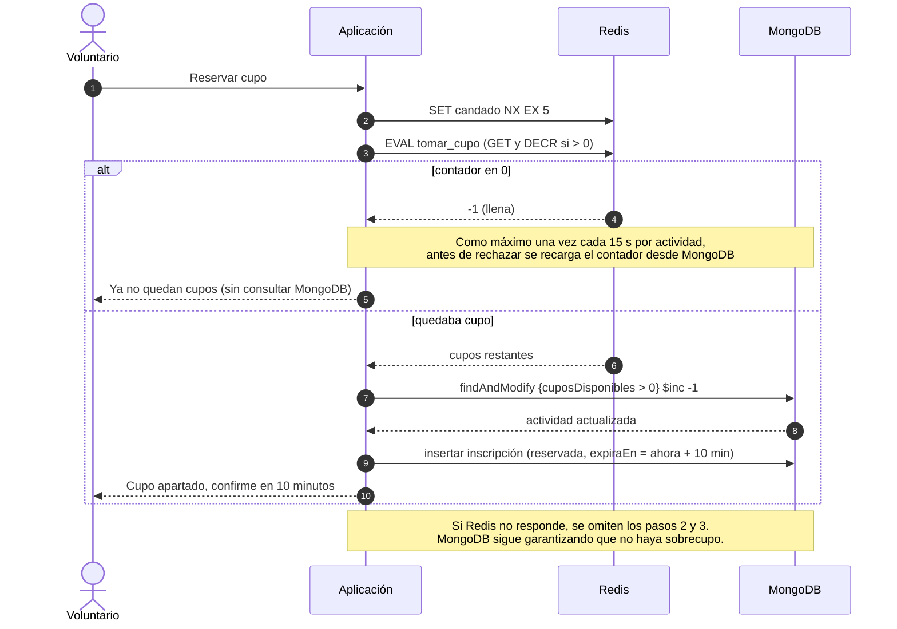

# Arquitectura v1

VoluntaCR es una aplicación web en PHP (sin framework ni Composer) con dos motores de datos:
**MongoDB** (el instalado en el servidor del curso) como fuente de verdad y **Redis** como
acelerador. MongoDB Atlas es el mismo motor en la nube y queda como alternativa cambiando solo la
URI; no se usan los dos a la vez (decisión D10). Es un proyecto de **perfil B**
(dos motores): cada motor tiene un rol claro, se explica cómo se mantienen consistentes y qué
pasa si uno de los dos falla.

Los correos (la confirmación de la cuenta y los avisos a los inscritos) salen por **Mailjet**, un
servicio externo, no un motor de datos: lo que se envía queda primero en MongoDB.

## Diagrama

## Qué dato vive en cada motor y por qué

| Dato | Motor | Por qué |
|---|---|---|
| Organizaciones, usuarios y sus roles, actividades, inscripciones, asistencia | MongoDB | Es lo que no se puede perder. Las actividades tienen campos variables (imágenes, requisitos) y la inscripción guarda una copia de la actividad para el historial: el modelo documental encaja sin tablas intermedias. |
| Metadatos de las imágenes | MongoDB (dentro de la actividad) | Siempre se leen junto con la actividad y son pocas (máximo 6). |
| Archivos de imagen | Disco (`public/uploads/`) | El servidor web los entrega directo; guardarlos en la base solo agregaría carga. |
| Contador de cupos por actividad | Redis | Un script Lua resta un cupo solo si quedan, en una operación atómica de microsegundos. Cuando la actividad se llena, las solicitudes se rechazan sin tocar MongoDB. |
| Candado contra doble envío | Redis | `SET NX` con vencimiento de 5 s: el doble clic no genera dos reservas. |
| Listado de actividades en caché | Redis | Es la página más visitada; se guarda 60 s y se invalida al cambiar algo. |
| Copia de respaldo del listado | Redis | Si MongoDB cae, el portal sigue mostrando la última versión conocida (24 h). |
| Intentos fallidos de inicio de sesión | Redis | Contador con vencimiento de 15 min para frenar ataques por fuerza bruta. |
| Bitácora de eventos de inscripciones | Redis (stream) | Registro de apoyo de reservas, confirmaciones, cancelaciones y vencimientos, limitado a unos 10 000 eventos; `/estado` muestra los últimos. El estado real de cada inscripción sigue en MongoDB. |
| Visitas por actividad y día | Redis (hash) | Dato de apoyo para el panel del coordinador: cada visita es una suma en Redis, sin escribir en MongoDB. Si se pierde, solo se pierden visitas (D18). |
| Ranking de voluntarios por horas | Redis (sorted set) | `ZINCRBY` al guardar la asistencia, y el puesto sale ordenado sin recorrer todas las asistencias. Se reconstruye desde MongoDB cada hora (D20). |
| Sesiones de usuario | Archivos de PHP | Decisión consciente: si Redis cae, nadie pierde su sesión. |
| Avisos a los inscritos (bandeja, lectura y estado del correo) | MongoDB | Un documento por persona (D24): la bandeja y el contador de no leídos se leen por persona con un índice, y el historial de la actividad sale de una agregación. Es también la bandeja de salida de los correos (D25). |
| Token de confirmación del correo | MongoDB (dentro del usuario) | Solo su SHA-256, con vencimiento de 48 h (D23). Tiene que sobrevivir a una caída de Redis. |
| Correos | Mailjet (servicio externo) | Se envían después de guardar el aviso; si Mailjet falla, el aviso ya está en el portal y el correo se reintenta. |

El detalle de colecciones y claves está en [modelo-datos.md](../modelo-datos.md) y [redis-claves.md](../redis-claves.md).

## Flujo principal: reservar un cupo

## ¿Qué ocurre si Redis se cae?

1. `RedisSeguro` intenta conectar con un tiempo límite de 0,5 s. Si falla, anota la hora en
   `storage/redis_caido_hasta.txt` y durante 30 s ninguna solicitud vuelve a intentarlo
   (interruptor o *circuit breaker*), para no esperar en cada página.
2. Las reservas van directo a MongoDB: la operación `findAndModify` con la condición
   `cuposDisponibles > 0` sigue impidiendo el sobrecupo. Solo se pierde velocidad bajo carga.
3. El listado se consulta en MongoDB en cada visita (sin caché).
4. No hay límite de intentos de inicio de sesión mientras Redis esté caído.
5. La bitácora de eventos no anota nada; las inscripciones sí se guardan en MongoDB.
6. No se cuentan las visitas (el panel del coordinador muestra "—") y el ranking de "Mis horas" se
   calcula en MongoDB con una agregación.
7. Los mensajes de la organización a los inscritos se envían sin el candado contra el doble clic.
   Los avisos y los correos funcionan igual: no dependen de Redis.
8. Los coordinadores ven una franja que avisa "Modo respaldo", y `/estado` lo muestra.

Cuando Redis vuelve, la aplicación lo usa de nuevo a más tardar 30 s después (el interruptor), sin
reiniciar nada:

- **Contadores de cupos.** Si un cupo se devolvió (cancelación, reserva vencida o cambio del cupo)
  mientras Redis no respondía, la clave no se pudo borrar y el contador de esa actividad queda más
  bajo que el real. La primera reserva que la encuentra "llena" lo confirma en MongoDB, como máximo
  una vez cada 15 s por actividad: libera las reservas vencidas, borra el contador y lo vuelve a
  cargar. Un contador más alto que el real no causa sobrecupo, porque MongoDB rechaza la reserva y
  la clave se borra.
- **Caché del listado.** Los cambios hechos durante la caída no subieron la versión de la caché, así
  que una página guardada antes de la caída se puede seguir mostrando hasta 60 s.
- **Ranking de horas.** Las asistencias guardadas durante la caída no sumaron en el ranking. El
  desfase se corrige cuando la clave vence (a más tardar en una hora) y se reconstruye desde MongoDB.

## ¿Qué ocurre si MongoDB se cae?

MongoDB es la fuente de verdad, así que no se puede reservar ni modificar nada (página 503 con
un mensaje claro). El listado de actividades se sigue mostrando desde la caché de Redis o desde su
copia de respaldo, y `/estado` indica "MongoDB no responde".

Si MongoDB deja de responder justo después de que Redis descontó un cupo, el contador de Redis se
borra, para que no quede un cupo descontado sin reserva; se vuelve a cargar cuando MongoDB responda.

## ¿Qué ocurre si Mailjet no responde?

1. Los avisos se guardan igual en MongoDB y aparecen en la bandeja del portal: el correo es un canal
   más, no la fuente (D25).
2. Cada llamada espera como máximo `MAILJET_TIMEOUT` (5 s). Si un lote de 50 correos no tiene
   respuesta, los demás no se intentan en esa misma solicitud.
3. Los correos quedan como `fallido` y `scripts/enviar_correos.php` los reintenta cada 5 minutos,
   hasta 3 veces durante 48 horas. `/estado` muestra cuántos hay pendientes o fallidos.
4. Una cuenta nueva no recibe su enlace de confirmación. Desde «Confirme su correo» puede pedir otro
   cuando Mailjet vuelva, y la administración también puede reenviarlo.
5. Sin las claves de Mailjet (desarrollo), ningún correo sale: se anotan en `storage/correos.log` y
   el enlace de confirmación se muestra en la página, en el mismo navegador (D23).

## ¿Cómo se mantienen consistentes?

- **Contador de cupos:** MongoDB tiene el valor real (`cuposDisponibles`). Redis tiene una copia
  que se carga la primera vez (`SET NX` con 1 h de vencimiento). Cada vez que un cupo se devuelve
  (cancelación, reserva vencida, cambio del cupo total) la clave de Redis se **borra** y se vuelve
  a cargar en la siguiente reserva. Si Redis deja pasar una solicitud de más, MongoDB la rechaza y
  la clave también se borra. Si Redis dice que la actividad está llena, como máximo cada 15 s se
  confirma en MongoDB y se recarga el contador.
- **Caché del listado:** se invalida por versión. Cualquier cambio incrementa
  `cache:actividades:version`; las claves viejas dejan de usarse y expiran solas a los 60 s.
- **Copia de la actividad dentro de la inscripción:** cuando el coordinador edita la actividad, se
  actualiza en todas sus inscripciones (gancho `actividad.actualizada`).
- **Red de seguridad:** `scripts/reconciliar_cupos.php` recalcula los cupos desde las inscripciones.

## Qué se va a medir

Ver la sección de mediciones del [README](../../README.md#mediciones). La principal:
500 inscripciones simultáneas sobre una actividad de 50 cupos, con Redis y sin Redis
(`scripts/medir_cupos.php`), comparando tiempo total, latencia y sobrecupo
([detalle](../mediciones/cupos.md)).
