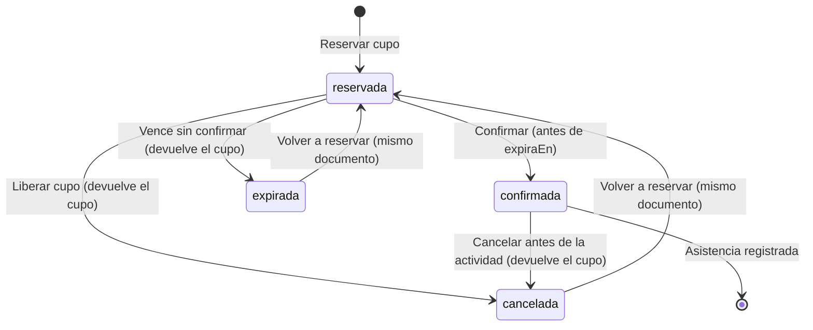

# Modelo de datos v1 (MongoDB)

Base de datos: `voluntacr` (configurable con `MONGO_DB`).
Se crea con `php scripts/crear_esquema.php`, que aplica la validación **JSON Schema** y los índices.

## Dónde corre MongoDB

- **Servidor del curso:** el MongoDB instalado en el servidor (motor principal, decisión D10).
- **Desarrollo:** MongoDB 7 local o con Docker (`docker compose up`).
- **Alternativa:** MongoDB Atlas, que es el mismo motor alojado en la nube. Solo cambia `MONGO_URI`.
  Si se usa: clúster en AWS Oregon (us-west-2), acceso solo desde la IP del servidor (nunca
  `0.0.0.0/0`) y la URI únicamente en el `.env` del servidor.

## Colecciones

### `organizaciones`

| Campo | Tipo | Notas |
|---|---|---|
| `_id` | ObjectId | |
| `nombre` | string | único (índice `nombre_unico`) |
| `descripcion` | string | opcional |
| `provincia` | string | una de las 7 provincias |
| `contacto` | string | correo público de la organización |
| `creadaEn` | date | |

### `usuarios`

| Campo | Tipo | Notas |
|---|---|---|
| `_id` | ObjectId | |
| `nombre` | string | 3 a 80 caracteres |
| `correo` | string | único (índice `correo_unico`), en minúsculas |
| `claveHash` | string | `password_hash()` de PHP; la contraseña nunca se guarda |
| `rol` | string | `voluntario`, `coordinador` o `admin` |
| `provincia` | string o null | opcional |
| `organizacion` | `{id, nombre}` o null | solo coordinadores (referencia + copia del nombre) |
| `activo` | bool | `false` = desactivada; las cuentas no se borran |
| `creadoEn` | date | |
| `creadoPor` | ObjectId o null | administrador que la creó; null si se registró sola |
| `actualizadoEn`, `actualizadoPor` | date, ObjectId | último cambio y quién lo hizo |
| `sesionesValidasDesde` | date | las sesiones iniciadas antes se cierran (contraseña restablecida o cuenta desactivada) |

Roles:

| Rol | Cómo se crea | Qué puede hacer |
|---|---|---|
| `voluntario` | Registro público o administración | Reservar cupos, ver sus inscripciones y horas |
| `coordinador` | Administración (o `scripts/crear_coordinador.php`) | Publicar actividades de su organización, ver inscritos y pasar asistencia |
| `admin` | Pantalla Administradores (o `scripts/crear_admin.php` para el primero) | Crear, editar, desactivar y restablecer contraseñas de cualquier cuenta |

### `actividades` (entidad central)

| Campo | Tipo | Notas |
|---|---|---|
| `_id` | ObjectId | |
| `titulo` | string | 5 a 120 |
| `descripcion`, `requisitos` | string | |
| `categoria` | string | `ambiente`, `playas`, `educacion`, `salud`, `animales`, `comunidad` |
| `provincia`, `lugar` | string | |
| `fechaInicio` | date | en UTC; se muestra en hora de Costa Rica |
| `horas` | number | horas que acredita (0,5 a 24) |
| `cupoTotal` | int | 1 a 500 |
| `cuposDisponibles` | int | **≥ 0 y ≤ cupoTotal**, lo exige el validador de la base |
| `estado` | string | `borrador`, `publicada`, `cancelada` |
| `organizacion` | `{id, nombre}` | referencia + copia del nombre |
| `coordinadorId` | ObjectId | quién la creó |
| `imagenes` | arreglo (máx. 6) | `{archivo, tipo, bytes, ancho, alto, original, subidaEn}` |
| `portada` | string o null | nombre del archivo de portada |
| `creadaEn`, `actualizadaEn` | date | |

### `inscripciones`

| Campo | Tipo | Notas |
|---|---|---|
| `_id` | ObjectId | |
| `actividadId`, `voluntarioId` | ObjectId | referencias; **par único** (índice `una_por_persona`) |
| `estado` | string | `reservada` → `confirmada`, o `cancelada` / `expirada` |
| `reservadaEn`, `expiraEn` | date | la reserva vence en `RESERVA_MINUTOS` (10) |
| `confirmadaEn`, `canceladaEn`, `expiradaEn` | date o null | |
| `actividad` | objeto | copia: título, fecha, horas, categoría, lugar, provincia, organización |
| `voluntario` | objeto | copia: nombre y correo |
| `asistencia` | objeto o null | `{presente, horas, registradaEn, registradaPor}` |
| `creadaEn` | date | |

Estados de una inscripción:

## Embebido o referencia: decisiones

| Relación | Decisión | Motivo |
|---|---|---|
| Actividad → imágenes | **Embebido** | Máximo 6, siempre se muestran con la actividad, nadie las consulta solas. |
| Actividad → organización | **Referencia + copia del nombre** | El listado muestra el nombre sin un `$lookup`; el nombre casi nunca cambia. |
| Inscripción → actividad | **Referencia + copia** (título, fecha, horas…) | "Mis inscripciones" y el historial de horas se leen sin unir colecciones. Si el coordinador edita la actividad, la copia se actualiza en todas sus inscripciones. |
| Actividad → inscripciones | **Colección aparte** (no embebido) | Una actividad puede tener cientos de inscripciones; embebidas, el documento crecería sin límite y cada reserva reescribiría el documento completo. Además el índice único `(actividadId, voluntarioId)` impide inscripciones dobles. |
| Usuario → horas | **Calculado** con aggregation pipeline sobre `inscripciones` | Una sola fuente de verdad; no hay contador que se pueda desfasar. |

## Índices

| Colección | Índice | Para qué |
|---|---|---|
| organizaciones | `{nombre: 1}` único | evitar duplicados |
| usuarios | `{correo: 1}` único | inicio de sesión y correos únicos |
| usuarios | `{rol: 1, nombre: 1}` | pantallas de administración |
| actividades | `{estado: 1, fechaInicio: 1}` | portal ordenado por fecha |
| actividades | `{estado: 1, categoria: 1, provincia: 1, fechaInicio: 1}` | portal con filtros |
| actividades | `{organizacion.id: 1, fechaInicio: -1}` | panel del coordinador |
| inscripciones | `{actividadId: 1, voluntarioId: 1}` único | una inscripción por persona y actividad |
| inscripciones | `{estado: 1, expiraEn: 1}` | encontrar reservas vencidas |
| inscripciones | `{actividadId: 1, estado: 1}` | inscritos y asistencia |
| inscripciones | `{voluntarioId: 1, actividad.fechaInicio: -1}` | historial del voluntario |

El efecto de los dos índices del portal, comparados con recorrer toda la colección, se mide con
`explain()` en [mediciones/indice.md](mediciones/indice.md).

## Validación en la base (JSON Schema)

Además de la validación en PHP, MongoDB rechaza documentos inválidos. Lo más importante:

- `cuposDisponibles` con `minimum: 0` y la regla `$expr: {$lte: ["$cuposDisponibles", "$cupoTotal"]}`:
  aunque hubiera un error en el código, la base no acepta cupos negativos ni más cupos libres que el total.
- Enumeraciones para `categoria`, `provincia`, `estado` y `rol` (incluido `admin`).
- Patrón del correo y del nombre de archivo de las imágenes.

El esquema completo está en [`scripts/crear_esquema.php`](../scripts/crear_esquema.php).
